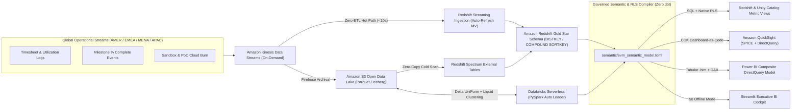

# Enterprise Streaming Lakehouse, Governed Semantic Layer & Executive EVM BI Platform


-success)

Production-grade reference architecture combining **Amazon Kinesis Data Streams**, an **Amazon S3 Open Data Lake (Apache Iceberg / Databricks Delta UniForm)**, **Amazon Redshift Serverless** (*Zero-ETL Streaming Ingestion + Redshift Spectrum + Physically Tuned Star Schema*), and a **Single Governed Semantic & Row-Level Security (RLS) Compiler** serving **Amazon QuickSight** and **Microsoft Power BI**.

Built around a high-stakes executive domain: **Global Enterprise Earned Value Management (EVM), Regional Workforce Utilization & Real-Time Cloud Burn Intelligence** across `AMER`, `EMEA`, `MENA`, and `APAC`.

---

## End-to-End Architecture



---

## Why This Architecture Matters (Key Engineering Highlights)

### 1. Eliminating the Naive `AVG(CPI)` BI Trap via a Governed Semantic Layer
Earned Value Management metrics (**CPI**, **SPI**, **EAC**, **TCPI**) are **non-additive ratios**. When BI analysts drag a column and pick `Average of CPI`, a small $180K PoC (`CPI = 1.45`) masks a $4.8M core banking migration bleeding budget at `CPI = 0.82` (inflating apparent portfolio health by **+400+ bps**).

`semantic/evm_semantic_model.toml` defines every metric and Row-Level Security persona **once** and compiles deterministically via `src/semantic_compiler.py` into **4 synchronized targets** (enforced in CI with `--check`):

| Target Layer | Compiled Artifact | How Governance & Performance Work |
| :--- | :--- | :--- |
| **Amazon Redshift** | `redshift/sql/05_governed_semantic_views.sql` | Weighted `SUM(cum_ev_usd) / NULLIF(SUM(cum_ac_total_usd), 0)` + `CREATE RLS POLICY` |
| **Databricks Unity Catalog** | `databricks/sql/unity_catalog_metric_views.sql` | Native `CREATE VIEW ... WITH METRICS LANGUAGE YAML` + `SET ROW FILTER` |
| **Amazon QuickSight** | `infra/quicksight_bi_stack.py` + `bi/quicksight/*.json` | Hybrid **SPICE** (Star Schema) + **DirectQuery** (`<10s` Kinesis anomalies) + RLS |
| **Microsoft Power BI** | `bi/powerbi/EVM_Semantic_Model.bim` + `evm_measures.dax` | Composite Mode (`DirectQuery` facts + `Dual` dimensions) + `DIVIDE()` DAX & RLS Roles |

### 2. Physical Amazon Redshift Star Schema Tuning (`DISTKEY` + `SORTKEY` + Zone Maps)
* **Zero-Shuffle Joins:** Small dimensions (`dim_project`, `dim_region`, `dim_date`) use `DISTSTYLE ALL`, while `fact_evm_daily` and `fact_utilization_daily` share `DISTKEY(project_sk)` so joins execute slice-locally with zero network redistribution.
* **1 MB Zone-Map Pruning:** `COMPOUND SORTKEY(snapshot_date, region_code, project_sk)` + `AZ64` encoding skips **85%–94%** of storage blocks on executive date + regional RLS queries.
* **Zero-ETL Streaming MV:** `redshift/sql/02_kinesis_streaming_mv.sql` ingests live Kinesis streams directly in SQL using Redshift's `SUPER` type and `AUTO REFRESH YES` — zero Lambda/Glue middleman.

### 3. Zero-`dbt` Lakehouse Interoperability (Delta UniForm ↔ Redshift Spectrum)
Databricks curates S3 Silver tables with `delta.universalFormat.enabledFormats = 'iceberg'`, allowing Redshift Spectrum (`01_spectrum_external_lake.sql`) to read the exact same S3 Parquet files with **zero storage duplication** and **zero third-party transformation tools**.

---

## Quickstart: Run 100% Locally in 60 Seconds (`$0` Cloud Bill)

```bash
# 1. Generate multi-region S3 Parquet baselines + Kinesis stream & run full warehouse simulator
make run-local

# 2. Launch the interactive 4-Sheet Executive BI Cockpit (RLS Switcher + Live Kinesis Injector)
make demo

# 3. Verify zero semantic drift & run unit / integration tests
python3 src/semantic_compiler.py --check
python3 -m unittest discover -s tests -v
```

### Cloud Deployment & Teardown (AWS CDK)

```bash
# Install full Python + AWS CDK CLI toolchain
make setup

# Synthesize & deploy Kinesis + S3 Open Lake + Redshift Serverless + QuickSight-as-Code
make synth
make deploy-aws

# Tear down all cloud resources cleanly when finished
make destroy-aws
make clean
```

---

## Repository Structure

```text
├── app/
│   └── executive_bi_cockpit.py           # Interactive Streamlit replica of QuickSight & Power BI
├── bi/
│   ├── powerbi/
│   │   ├── EVM_Semantic_Model.bim        # Import-ready Power BI Tabular Model + RLS Roles
│   │   ├── evm_measures.dax              # Compiled canonical DAX EVM & S-Curve measures
│   │   └── redshift_composite_directquery.pq
│   └── quicksight/
│       ├── dashboard_4_sheet_definition.json
│       └── dataset_spice_directquery_rls.json
├── databricks/
│   ├── databricks.yml                    # Databricks Asset Bundle (Serverless Job)
│   ├── pipelines/silver_delta_uniform_stream.py
│   └── sql/unity_catalog_metric_views.sql
├── docs/
│   ├── ARCHITECTURE_DECISIONS.md
│   ├── FINOPS_COST_ESTIMATE.md
│   └── WELL_ARCHITECTED_REVIEW.md
├── infra/                                # AWS CDK v2 Python Stacks
│   ├── app.py
│   ├── kinesis_datalake_stack.py
│   ├── redshift_warehouse_stack.py
│   └── quicksight_bi_stack.py
├── redshift/sql/                         # Native Redshift Spectrum, Streaming MV, DDL & PL/pgSQL
│   ├── 01_spectrum_external_lake.sql
│   ├── 02_kinesis_streaming_mv.sql
│   ├── 03_gold_star_schema_ddl.sql
│   ├── 04_sp_merge_evm_and_vacuum.sql
│   └── 05_governed_semantic_views.sql
├── scripts/
│   ├── export_env.py
│   └── generate_data.py
├── semantic/
│   └── evm_semantic_model.toml           # Single Source of Truth for Metrics & RLS
├── src/
│   ├── kinesis_simulator.py
│   ├── local_runner.py
│   ├── monte_carlo_evm.py
│   ├── redshift_simulator.py
│   └── semantic_compiler.py
└── tests/                                # EVM Math, Compiler Drift, Kinesis/Redshift & CDK Tests
```
